<p align="center">
  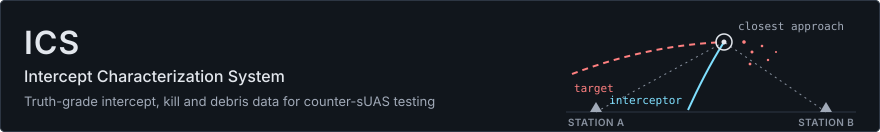
</p>

<p align="center">
  <a href="https://github.com/MatthewK84/ICS/actions/workflows/cpp-toolchain.yml"></a>
  <a href="https://github.com/MatthewK84/ICS/actions/workflows/python-toolchain.yml"></a>
  <a href="https://github.com/MatthewK84/ICS/actions/workflows/web-toolchain.yml"></a>
  <a href="https://github.com/MatthewK84/ICS/actions/workflows/codeql.yml"></a>
  <a href="https://github.com/MatthewK84/ICS/actions/workflows/dependency-register.yml"></a>
</p>

<p align="center">
  <a href="#what-ics-does"><b>What it does</b></a> ·
  <a href="#system-map"><b>System map</b></a> ·
  <a href="#find-your-way"><b>Find your way</b></a> ·
  <a href="#repository-layout"><b>Layout</b></a> ·
  <a href="#quality-gates"><b>Quality gates</b></a> ·
  <a href="#quick-start"><b>Quick start</b></a> ·
  <a href="#contributing"><b>Contributing</b></a>
</p>

> [!IMPORTANT]
> **Distribution: public.** ICS is developed from publicly available information only. Never commit CUI, CTI, export-controlled, classified or proprietary material. [SECURITY.md](SECURITY.md) lists what stays out of this repository and how to report a problem.

## What ICS does

ICS produces truth-grade intercept, kill and debris data for non-explosive hit-to-kill counter-sUAS interceptors. It adapts the OWLSS stereo-optical tracking approach and fuses it with the interceptor's and the target's Position Location Information (PLI).

- **Every station times and keeps everything it sees.** Packets, PLI from four feeds, high-speed camera frames and mount encoder angles are each time-stamped in UTC nanoseconds, from PTP and GPS PPS.
- **Stations point themselves.** A cue from the target's PLI and radar tracks brings each mount onto the target, and a closed-loop tracker on the narrow-field camera holds it there.
- **The run becomes measurements** (Phase 4). Two or more stations triangulate the endgame. The products will report closest approach, contact time, debris and a kill classification, each traceable to its raw data.
- **Every result can be checked.** Each algorithm is modelled in Python first, and its C++ port is held to golden vectors. Run records will carry SHA-256 manifests and in-toto attestations.

## System map

Each card opens the code it names, and the dashed planned cards open their build-plan tasks. Hover over a card for a one-line description. Stages run in the order data moves through a station, and their phases are the [build plan](docs/build-plan.md)'s.

**SOURCES** · what each station hears and sees

<p>
<a href="proto/ics/v1/pli.proto" title="The record every PLI adapter turns a target's position reports into"><picture><source media="(prefers-color-scheme: dark)" srcset="docs/assets/readme/map/source-pli-dark.svg">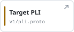</picture></a>
<a href="cpp/sapient/" title="Radar tracks over SAPIENT (BSI Flex 335)"><picture><source media="(prefers-color-scheme: dark)" srcset="docs/assets/readme/map/source-radar-dark.svg">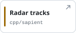</picture></a>
<a href="cpp/camera/" title="Phantom and FLIR X6980 high-speed cameras"><picture><source media="(prefers-color-scheme: dark)" srcset="docs/assets/readme/map/source-video-dark.svg"></picture></a>
<a href="cpp/tracker/" title="The narrow-field GigE Vision camera the tracker steers by"><picture><source media="(prefers-color-scheme: dark)" srcset="docs/assets/readme/map/source-tracking-dark.svg">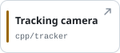</picture></a>
<a href="firmware/" title="The mount's axis encoders, time-tagged against GPS PPS"><picture><source media="(prefers-color-scheme: dark)" srcset="docs/assets/readme/map/source-encoders-dark.svg">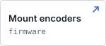</picture></a>
</p>

**INGEST · PHASE 1** · capture and decode every feed

<p>
<a href="cpp/services/capd/" title="ics-capd: every packet on the station's TAP ports, captured to pcap"><picture><source media="(prefers-color-scheme: dark)" srcset="docs/assets/readme/map/capture-dark.svg">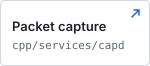</picture></a>
<a href="cpp/mavlink/" title="PLI adapter for MAVLink"><picture><source media="(prefers-color-scheme: dark)" srcset="docs/assets/readme/map/mavlink-dark.svg">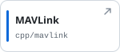</picture></a>
<a href="cpp/cot/" title="PLI adapter for Cursor on Target XML"><picture><source media="(prefers-color-scheme: dark)" srcset="docs/assets/readme/map/cot-dark.svg">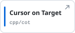</picture></a>
<a href="cpp/lattice/" title="PLI adapter for Lattice entity streams"><picture><source media="(prefers-color-scheme: dark)" srcset="docs/assets/readme/map/lattice-dark.svg">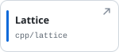</picture></a>
<a href="cpp/sapient/" title="Radar-track adapter for BSI Flex 335"><picture><source media="(prefers-color-scheme: dark)" srcset="docs/assets/readme/map/sapient-dark.svg">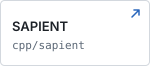</picture></a>
</p>

**TIME &amp; CAMERAS · PHASE 1** · one UTC time base for every frame

<p>
<a href="cpp/services/timingd/" title="ics-timingd: the station's PTP time quality, served over gRPC"><picture><source media="(prefers-color-scheme: dark)" srcset="docs/assets/readme/map/timing-dark.svg">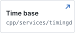</picture></a>
<a href="cpp/strobe/" title="Each camera's frame-time offset, measured with a strobe"><picture><source media="(prefers-color-scheme: dark)" srcset="docs/assets/readme/map/strobe-dark.svg">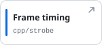</picture></a>
<a href="cpp/camera/" title="Phantom and FLIR camera drivers and offload"><picture><source media="(prefers-color-scheme: dark)" srcset="docs/assets/readme/map/camera-dark.svg">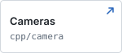</picture></a>
<a href="cpp/services/camd/" title="ics-camd: one command arms and offloads every camera"><picture><source media="(prefers-color-scheme: dark)" srcset="docs/assets/readme/map/camd-dark.svg">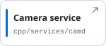</picture></a>
</p>

**STORE &amp; ALIGN · PHASE 1** · keep every report, on one clock

<p>
<a href="cpp/services/plid/" title="ics-plid: every vehicle's PLI from every feed, in segment logs and Parquet"><picture><source media="(prefers-color-scheme: dark)" srcset="docs/assets/readme/map/plid-dark.svg">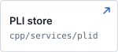</picture></a>
<a href="cpp/flightlog/" title="PX4 ULog and ArduPilot DataFlash import"><picture><source media="(prefers-color-scheme: dark)" srcset="docs/assets/readme/map/flightlog-dark.svg">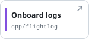</picture></a>
<a href="cpp/timealign/" title="Each vehicle's boot clock fitted to UTC after a sortie"><picture><source media="(prefers-color-scheme: dark)" srcset="docs/assets/readme/map/timealign-dark.svg">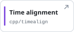</picture></a>
</p>

**STATION CONTROL · PHASE 2** · point at the target and hold it

<p>
<a href="cpp/tagger/" title="The encoder time-tagger's core, shared with the firmware"><picture><source media="(prefers-color-scheme: dark)" srcset="docs/assets/readme/map/tagger-dark.svg">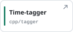</picture></a>
<a href="cpp/encoder/" title="Each camera frame's line of sight from encoder angles"><picture><source media="(prefers-color-scheme: dark)" srcset="docs/assets/readme/map/encoder-dark.svg">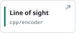</picture></a>
<a href="cpp/cue/" title="PLI and radar fused into each station's pointing cue"><picture><source media="(prefers-color-scheme: dark)" srcset="docs/assets/readme/map/cue-dark.svg">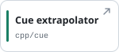</picture></a>
<a href="cpp/tracker/" title="Closed-loop tracking on the narrow-field camera"><picture><source media="(prefers-color-scheme: dark)" srcset="docs/assets/readme/map/tracker-dark.svg">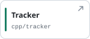</picture></a>
<a href="cpp/mount/" title="PWI4 client, rate loop and sun keep-out interlock"><picture><source media="(prefers-color-scheme: dark)" srcset="docs/assets/readme/map/mount-dark.svg">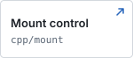</picture></a>
</p>

**PRODUCTS · PHASE 4** · planned: the measurements of the intercept

<p>
<a href="docs/build-plan.md#phase-4-algorithms-and-products-c-months-6-to-14" title="Planned: per-frame line of sight and refraction"><picture><source media="(prefers-color-scheme: dark)" srcset="docs/assets/readme/map/registration-dark.svg">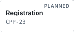</picture></a>
<a href="docs/build-plan.md#phase-4-algorithms-and-products-c-months-6-to-14" title="Planned: CUDA detection and TensorRT segmentation"><picture><source media="(prefers-color-scheme: dark)" srcset="docs/assets/readme/map/detection-dark.svg">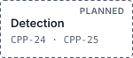</picture></a>
<a href="docs/build-plan.md#phase-4-algorithms-and-products-c-months-6-to-14" title="Planned: closest approach and contact time"><picture><source media="(prefers-color-scheme: dark)" srcset="docs/assets/readme/map/endgame-dark.svg"></picture></a>
<a href="docs/build-plan.md#phase-4-algorithms-and-products-c-months-6-to-14" title="Planned: debris association, estimation, kill class and footprint"><picture><source media="(prefers-color-scheme: dark)" srcset="docs/assets/readme/map/debris-dark.svg">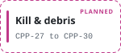</picture></a>
<a href="docs/build-plan.md#phase-4-algorithms-and-products-c-months-6-to-14" title="Planned: signed run records and the read-only API"><picture><source media="(prefers-color-scheme: dark)" srcset="docs/assets/readme/map/record-dark.svg">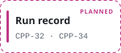</picture></a>
</p>

**REFERENCE MODELS · PHASE 3** · Python first; C++ held to golden vectors

<p>
<a href="python/ics_models/pointing/" title="Reference pointing model and its fit"><picture><source media="(prefers-color-scheme: dark)" srcset="docs/assets/readme/map/py-pointing-dark.svg">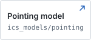</picture></a>
<a href="python/ics_models/cue/" title="Reference cue extrapolator"><picture><source media="(prefers-color-scheme: dark)" srcset="docs/assets/readme/map/py-cue-dark.svg">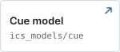</picture></a>
<a href="python/ics_models/tracker/" title="Reference centroid, geometry and estimator"><picture><source media="(prefers-color-scheme: dark)" srcset="docs/assets/readme/map/py-tracker-dark.svg">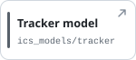</picture></a>
<a href="python/ics_sitl/" title="Software-in-the-loop flights for the adapters"><picture><source media="(prefers-color-scheme: dark)" srcset="docs/assets/readme/map/py-sitl-dark.svg">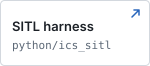</picture></a>
<a href="golden/" title="Files the C++ ports must reproduce"><picture><source media="(prefers-color-scheme: dark)" srcset="docs/assets/readme/map/golden-dark.svg"></picture></a>
</p>

**FOUNDATIONS · PHASES 0 TO 1** · contracts and libraries every service shares

<p>
<a href="proto/" title="Protobuf messages and services, the single source of truth"><picture><source media="(prefers-color-scheme: dark)" srcset="docs/assets/readme/map/proto-dark.svg">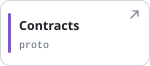</picture></a>
<a href="cpp/common/" title="Results, units, checks and fixed-capacity containers"><picture><source media="(prefers-color-scheme: dark)" srcset="docs/assets/readme/map/common-dark.svg"></picture></a>
<a href="cpp/logging/" title="Structured logging, set up once per service"><picture><source media="(prefers-color-scheme: dark)" srcset="docs/assets/readme/map/logging-dark.svg">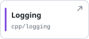</picture></a>
<a href="cpp/config/" title="TOML configuration read against a schema in code"><picture><source media="(prefers-color-scheme: dark)" srcset="docs/assets/readme/map/config-dark.svg">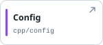</picture></a>
<a href="cpp/frames/" title="WGS84, the range ENU frame and EGM96 heights"><picture><source media="(prefers-color-scheme: dark)" srcset="docs/assets/readme/map/frames-dark.svg">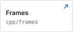</picture></a>
</p>

Language boundaries follow the [build plan](docs/build-plan.md):
- C++ owns every real-time path.
- Python never runs in the live capture or control path.
- The web UI never commands instrumentation.

Positions are WGS84 and the range ENU frame, heights are EGM96 for mean sea level, and every time is UTC nanoseconds; [frames and time](docs/frames-and-time.md) defines them.

## Find your way

| I want to… | Start here |
|---|---|
| Understand the plan, its phases and the coding standards | [docs/build-plan.md](docs/build-plan.md) |
| See what is built and what comes next | [The issue index](docs/github-issues-path-b.md) and the [milestones](https://github.com/MatthewK84/ICS/milestones) |
| Change a message or a service contract | [proto/](proto/README.md) |
| Work on a real-time service, adapter or station control | [cpp/](cpp/README.md) and the [C++ module list](#c-modules) below |
| Write or change a reference model | [python/](python/README.md) |
| Add or regenerate golden test vectors | [golden/](golden/README.md) |
| Work on the operator and evaluator interface | [web/](web/README.md) |
| Build the images, benches and CI | [deploy/](deploy/README.md) and [deploy/toolchain/](deploy/toolchain/README.md) |
| Look up positions, heights and time | [docs/frames-and-time.md](docs/frames-and-time.md) |
| Follow the C++ rules, or record a deviation | [docs/cpp-jsf-av.md](docs/cpp-jsf-av.md) |
| Add a dependency | [docs/dependency-register.md](docs/dependency-register.md) |
| Use an AI assistant on a change | [docs/ai-usage.md](docs/ai-usage.md) |
| Report a security problem | [SECURITY.md](SECURITY.md) |

## Repository layout

Each card opens its directory. Contracts are the single source of truth: `proto/` generates the C++, Python and TypeScript messages, and `golden/` holds each C++ port to its Python reference.

<p>
<a href="proto/" title="Protobuf contracts, the single source of truth"><picture><source media="(prefers-color-scheme: dark)" srcset="docs/assets/readme/dirs/dir-proto-dark.svg">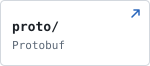</picture></a>
<a href="schemas/" title="Run-record JSON Schema keyed to C4 IDs"><picture><source media="(prefers-color-scheme: dark)" srcset="docs/assets/readme/dirs/dir-schemas-dark.svg">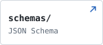</picture></a>
<a href="golden/" title="Cross-language golden test vectors"><picture><source media="(prefers-color-scheme: dark)" srcset="docs/assets/readme/dirs/dir-golden-dark.svg">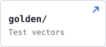</picture></a>
<a href="cpp/" title="Real-time and production data paths and services"><picture><source media="(prefers-color-scheme: dark)" srcset="docs/assets/readme/dirs/dir-cpp-dark.svg">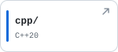</picture></a>
<a href="firmware/" title="Encoder time-tagger firmware"><picture><source media="(prefers-color-scheme: dark)" srcset="docs/assets/readme/dirs/dir-firmware-dark.svg">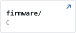</picture></a>
<a href="python/" title="Reference models, calibration, synthetic data, statistics"><picture><source media="(prefers-color-scheme: dark)" srcset="docs/assets/readme/dirs/dir-python-dark.svg">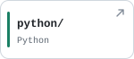</picture></a>
<a href="web/" title="Read-only operator and evaluator interface"><picture><source media="(prefers-color-scheme: dark)" srcset="docs/assets/readme/dirs/dir-web-dark.svg">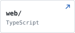</picture></a>
<a href="deploy/" title="Containers, CI images, benches, systemd units"><picture><source media="(prefers-color-scheme: dark)" srcset="docs/assets/readme/dirs/dir-deploy-dark.svg">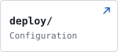</picture></a>
<a href="docs/" title="Build plan, issue index, standards, repository guides"><picture><source media="(prefers-color-scheme: dark)" srcset="docs/assets/readme/dirs/dir-docs-dark.svg">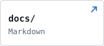</picture></a>
<a href="planning/" title="Task manifest used to sync milestones"><picture><source media="(prefers-color-scheme: dark)" srcset="docs/assets/readme/dirs/dir-planning-dark.svg">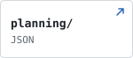</picture></a>
</p>

<details>
<summary><b>What each directory holds</b></summary>
<br>

| Directory | Contents | Language |
|---|---|---|
| [`proto/`](proto/) | Protobuf contracts, the single source of truth | Protobuf |
| [`schemas/`](schemas/) | Run-record JSON Schema keyed to C4 IDs | JSON Schema |
| [`golden/`](golden/) | Cross-language golden test vectors | Data |
| [`cpp/`](cpp/) | Real-time and production data paths and services | C++20 |
| [`firmware/`](firmware/) | Encoder time-tagger firmware | C |
| [`python/`](python/) | Reference models, calibration, synthetic data, statistics | Python |
| [`web/`](web/) | Read-only operator and evaluator interface | TypeScript, React |
| [`deploy/`](deploy/) | Containers, CI images, benches, systemd units | Configuration |
| [`docs/`](docs/) | Build plan, issue index, standards, repository guides | Markdown |
| [`planning/`](planning/) | Task manifest used to sync milestones | JSON |

Each directory's README lists its contents, its rules and the issues that added them.

</details>

<details id="c-modules">
<summary><b>C++ modules</b>: 21 modules, each linked to its section of <a href="cpp/README.md">cpp/README.md</a></summary>
<br>

| Module | Directory | What it does |
|---|---|---|
| [Common library](cpp/README.md#common-library) | `common/` | Results, units, checks and fixed-capacity containers that every real-time component links |
| [Logging](cpp/README.md#logging) | `logging/` | Structured logging, set up once per service |
| [Config](cpp/README.md#config) | `config/` | TOML configuration, read against a schema written as code |
| [Frames](cpp/README.md#frames) | `frames/` | Conversions between WGS84, the range ENU frame and EGM96 heights |
| [Timing](cpp/README.md#timing) | `timing/`, `services/timingd/` | The station's PTP time quality, served by `ics-timingd` |
| [Capture](cpp/README.md#capture) | `capture/`, `services/capd/` | Every packet on the station's TAP ports, captured by `ics-capd` |
| [MAVLink](cpp/README.md#mavlink) | `mavlink/` | PLI adapter for MAVLink |
| [Cursor on Target](cpp/README.md#cursor-on-target) | `cot/` | PLI adapter for CoT XML |
| [Lattice](cpp/README.md#lattice) | `lattice/` | PLI adapter for Lattice entity streams |
| [SAPIENT](cpp/README.md#sapient) | `sapient/` | Radar-track adapter for BSI Flex 335 |
| [Onboard logs](cpp/README.md#onboard-logs) | `flightlog/` | Import of PX4 ULog and ArduPilot DataFlash logs |
| [Time alignment](cpp/README.md#time-alignment) | `timealign/` | Each vehicle's clock fitted to UTC after a sortie |
| [PLI store](cpp/README.md#pli-store) | `store/`, `services/plid/` | Segment log and Parquet store, served by `ics-plid` |
| [Cameras](cpp/README.md#cameras) | `camera/` | Phantom and FLIR high-speed camera drivers and offload |
| [Camera service](cpp/README.md#camera-service) | `services/camd/` | `ics-camd`: one command arms and offloads every camera |
| [Strobe calibration](cpp/README.md#strobe-calibration) | `strobe/` | Each camera's frame-time offset, measured with a strobe |
| [Mount client](cpp/README.md#mount-client) | `mount/` | PWI4 client, rate loop and sun keep-out interlock |
| [Encoder time-tagger](cpp/README.md#encoder-time-tagger) | `tagger/` | The time-tagger's core, shared with the firmware |
| [Encoder module](cpp/README.md#encoder-module) | `encoder/` | Each camera frame's line of sight from encoder angles |
| [Cue extrapolator](cpp/README.md#cue-extrapolator) | `cue/` | PLI and radar fused into each station's pointing cue |
| [Tracker](cpp/README.md#tracker) | `tracker/` | Closed-loop tracking on the narrow-field camera, through Aravis |

</details>

## Quality gates

Every change reaches `main` through a pull request, and CI enforces each gate below.

| Gate | What it holds | Details |
|---|---|---|
| Power of Ten | Warnings as errors, a strict clang-tidy profile and no suppression markers in any language | [C++](cpp/README.md#power-of-ten-checks), [Python](python/README.md#power-of-ten-checks), [web](web/README.md#power-of-ten-checks) |
| JSF AV C++ | The JSF AV rules on every new C++ module, with each deviation registered | [docs/cpp-jsf-av.md](docs/cpp-jsf-av.md) |
| Sanitizers | ASan, UBSan and TSan on every C++ change | [Test stages](cpp/README.md#test-stages) |
| Coverage | Every line and branch of gated C++; at least 90% of Python and 80% of web code | [coverage-gates.txt](cpp/policy/coverage-gates.txt) |
| Golden parity | Each C++ port matches its Python reference | [golden/](golden/README.md) |
| Reproducible builds | Two GCC builds give byte-identical outputs | [Build](cpp/README.md#build) |
| CodeQL | Fails on any finding | [codeql.yml](.github/workflows/codeql.yml) |
| Dependencies | Every dependency pinned and reviewed for license, sustainment and foreign influence | [Dependency register](docs/dependency-register.md) |
| Evidence | A signed SBOM and provenance for every merge | [deploy/evidence/](deploy/evidence/README.md) |

## Quick start

Each toolchain runs in a pinned environment; its README has the full detail.

<details>
<summary><b>C++</b>: build and test inside the <code>ics-cpp</code> image</summary>

```sh
deploy/toolchain/conan-install.sh gcc-release   # dependencies from cpp/conan.lock
cd cpp
cmake --preset gcc-release
cmake --build --preset gcc-release
ctest --preset gcc-release
```

Presets pair `gcc` or `clang` with `debug`, `release`, `asan`, `ubsan` or `tsan`. See [cpp/README.md](cpp/README.md#build).

</details>

<details>
<summary><b>Python</b>: reference models, with uv pinned by hash</summary>

```sh
cd python
python3.12 -m venv /tmp/uv && /tmp/uv/bin/pip install --require-hashes --no-deps -r requirements-uv.txt
export PATH="/tmp/uv/bin:${PATH}"
uv sync --locked
uv run --locked ruff check . && uv run --locked mypy .
uv run --locked pytest
```

See [python/README.md](python/README.md#toolchain).

</details>

<details>
<summary><b>TypeScript</b>: the web workspace, with pnpm pinned</summary>

```sh
cd web
corepack enable && pnpm install --frozen-lockfile
pnpm run format:check && pnpm run lint && pnpm run typecheck
pnpm run test
```

See [web/README.md](web/README.md#toolchain).

</details>

## Contributing

Work the issues in numeric order within each milestone.
1. Open each issue by completing its task card: the goal, blocking questions, assumptions and plan.
2. Build it on a branch, and bring it to `main` in a pull request.
3. Close the issue only when its "Done when" test passes and the Definition of Done is complete.

- [Contributing](CONTRIBUTING.md): the workflow, task card, Definition of Done, branch naming and review rules.
- [Repository protection](docs/repository-protection.md): the rules on `main` and how changes get merged.
- [AI usage](docs/ai-usage.md): how AI-assisted changes are declared and reviewed.
- [Security](SECURITY.md): what never enters this repository, and how to report a problem.
